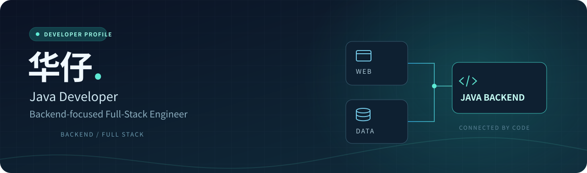
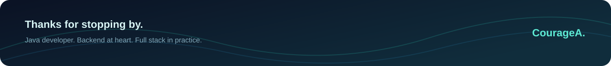

  

<h1 align="center">你好，我是华仔 👋</h1>

  <strong>Java 程序员 · 后端为主的全栈工程师</strong>

  以 Java 开发为核心，关注后端实现，也参与前端与后端的协作。

  <a href="https://github.com/CourageA?tab=repositories">浏览我的仓库 ↗</a>

---

### 关于我

- ☕ **Java 开发** — 我的主要开发语言是 Java。
- ⚙️ **后端为主** — 开发重心偏向服务端，关注业务逻辑与接口实现。
- 🧩 **全栈视角** — 从后端延伸到前端，关注功能的完整交付与前后端协作。

### 开发方向

| 方向 | 关注内容 |
| --- | --- |
| **Java / Backend** | 服务端开发、业务逻辑、接口设计 |
| **Full Stack** | 前后端联调、功能整合、端到端实现 |
| **Engineering** | 清晰的代码结构、可维护性、持续改进 |

### 在这里

这里是我的代码空间，欢迎浏览仓库、交流技术。

  

